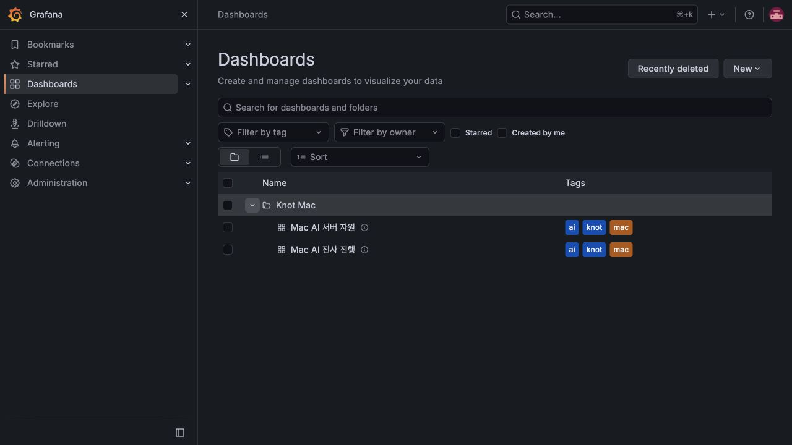

# #805 Grafana 목록과 HTTPS 검증

2026-10-18 검증. 기준 develop `52ffa1e6`, 작업 브랜치 `be/bugfix/#805`.
운영 상태는 읽었고 변경은 격리 환경에서 검증했다. 이 기록은 운영 배포 완료를 뜻하지 않는다.

## 장애 근거

- 운영 Grafana 13.2.3의 `/api/search`에서 `dash-folder`와 `dash-db`가 모두
  `uid=knot-mac`이고 호스트 대시보드의 `folderUid`도 `knot-mac`임을 확인했다.
- HTTPS 로그인·직접 대시보드는 열리지만 목록 폴더를 펼치면 브라우저에서
  `RangeError: Maximum call stack size exceeded`가 반복됐다(05:55:41 UTC).
- 이전 cgroup OOM과는 증상이 다르다. 이번 수정은 폴더 식별자와 provisioning을 대상으로 한다.
- 운영 Compose의 HTTPS root URL·domain enforcement·Secure 쿠키, Nginx 공개 TLS,
  Cloudflare realip·IPv4 방화벽 예외, Certbot timer·deploy hook을 읽어 코드화했다.

## 변경과 재현

| 요구 | 변경 | 검증 |
| --- | --- | --- |
| UID 충돌 제거 | 새 `knot-mac-folder`, 두 JSON version 변경 | 고정 이미지 기존 설치 이동·신규 설치 |
| URL·정의 보존 | dashboard UID·패널·쿼리 유지 | DB ID 및 version 제외 전체 정의 동일 |
| 안전한 정리 | 읽기 전용 기본, 빈 폴더·알림·권한·provisioned 검사 | 잘못된 이동·권한·내용 변경·백업 덮어쓰기 중단 |
| HTTPS 재현 | Compose overlay·systemd drop-in·Nginx·renderer·renew hook | Compose 병합·Nginx 구문·TLS 요청 |
| 수집 경계 보존 | 기본 ingress·loopback·Mac 예외 유지 | mTLS 5개 요청, nft 후보 검사 |
| 배포와 복구 | 유지보수·볼륨 백업·이동·HTTPS 활성화 runbook | 격리 재시작 확인, 운영 적용은 대기 |

backend 디렉터리에서 실행한다.

```sh
python3 -m unittest discover ops/observability/mac/central -p 'test_*.py' -v
python3 ops/observability/mac/central/verify_grafana.py
python3 ops/observability/mac/central/verify_https.py
python3 -m unittest discover ops/observability/mac -p 'test_*.py' -v
python3 -m unittest discover ops/observability/mac/ai -p 'test_*.py' -v
python3 -m unittest discover ../.github/scripts -p 'test_*.py' -v
```

- Grafana: Compose와 같은 고정 digest(13.2.3)로 기존 충돌 상태 → 새 폴더 이동 →
  빈 폴더 정리 → 재실행 무변경 → 컨테이너 재시작 → 신규 설치를 확인했다.
  기존 DB ID·version 제외 dashboard 정의와 재시작 후 응답이 유지됐다.
- 브라우저: 격리 이전 설치를 이동한 뒤 목록 펼치기에서 두 대시보드가 보였고 console error는 0건이다.
- HTTPS: `nginx:1.28-alpine`에서 공개 경로 200, metrics/debug 404, HTTP 301,
  수집 인증서 없음 400·잘못된 CN 403·Mac POST 204·Mac GET 403·다른 경로 403, 9/9.
  upstream은 대역이며 실제 Grafana 인증·운영 데이터 전송 검증으로 해석하지 않는다.
- Compose: 예시 도메인·비밀파일 디렉터리로 base+overlay `config --quiet` 통과.
- 방화벽: 당일 Cloudflare 공식 API IPv4 15개를 사용한 후보를 실제 EC2의
  `nft -c -f /dev/stdin`으로 검사했다. 적용·서비스 재시작은 하지 않았다.
- 신규 중앙 설정·이동 안전성 10, 기존 Mac 설치 11, AI 수집/PromQL 7, Governance 10 테스트 통과.
- `./gradlew spotlessCheck test integrationTest acceptanceTest bootJar --continue`: 5분 36초 성공.
  단위 1,717·통합 773·인수 586건, 실패·오류 0. 통합 중 실제 S3 opt-in 1건은 생략됐다.



## 컨벤션과 검증 경계

원문 00~08 hash 검사는 통과했다. 공통 검증 wrapper의 변경 범위 감사는 기존 build.gradle의
LIB-VERSION 3건, 전체 감사는 1,229건으로 실패하여 wrapper의 Gradle 단계는 실행되지 않았다.
진단이 있는 305개 파일을 기준 HEAD와 byte 비교해 모두 변경하지 않은 파일임을 확인했다.
이 감사 실패를 통과로 처리하거나 이 PR에서 무관한 Java·의존성을 수정하지 않는다.

| 규칙군 | 적용 판단 |
| --- | --- |
| STACK·LIB | 기존 Grafana·Prometheus 이미지 유지, 새 의존성 없음 |
| LAYER·MODEL·API·DB·JAVA | Spring 계층·업무 API·DB·Java 변경 없음 |
| TEST | 실패 안전성, 실제 Grafana 이동, TLS 경계, 기존 수집 회귀 |
| AI | 비밀값 제외, 실제/대역·운영/격리 증거 구분, 배포 전 사람 리뷰 |
| DELIVERY | #805 계약, 최신 develop에서 분기, 템플릿·원문 hash·PR 검증 |

운영 배포 후 확인할 것: Cloudflare Full(strict) 설정, 실제 인증서 갱신 dry-run, Secure 쿠키,
외부 출발지 제한, 최신 Mac 표본과 재시작. 격리 검증은 실제 DNS·Cloudflare 계정 설정이나
운영 백업 복원 시험을 증명하지 않는다. 기존 폴더 삭제는 유지보수 중 다른 쓰기가 없는 조건이다.
