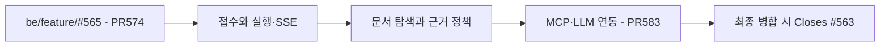

# #563 탐색 구현 PR 분리

## 분리 기준

사용자 요청으로 기존 약 5,095줄 production 변경을 세 PR로 나눈다. 원래 커밋을 보존하고 강제 push 없이 기존 #583의 base를 앞 단계 브랜치로 바꾼다. 모든 PR은 같은 #563에 연결한다. 마지막 #583에만 `Closes #563`을 사용한다.

| 단계 | 브랜치 | PR base | 책임 |
| --- | --- | --- | --- |
| 1 | `be/refactor/#563` | `be/feature/#565` | 첫 질문 원자적 접수·멱등성·영속 생성 작업·SSE |
| 2 | `be/chore/#563` | `be/refactor/#563` | ARCHIVED 문서 검색·목록·이어 읽기·전체 근거/세 카드 |
| 3 | `be/feature/#563` | `be/chore/#563` | 내부 MCP 인증/HTTP·LLM 도구 반복·답변 스트리밍·실제 연결 |

분리용 branch type은 저장소의 동일 Issue 번호 branch 규칙을 유지한다. 새 Issue를 생성하지 않는다. 각 PR의 제목·본문은 실제 기능 책임을 설명한다. 후속 #566~#569 endpoint와 운영 배포는 포함하지 않는다.

## 단계별 검증

각 branch HEAD에서 `spotlessCheck check bootJar`를 실행하고 단위·통합·인수 테스트 결과를 별도로 기록한다. 1/2단계에는 production 생성 adapter가 없어 기본 신규 접수를 거절한다. 3단계에서 실제 adapter를 연결하며 활성화 설정이 필요하다. 테스트 adapter 검증을 실제 모델 관측으로 표현하지 않는다.

문서 도구 테스트는 2단계에서 직접 서비스/DB를 검증하고, 3단계에서 실제 MCP HTTP·동시 Workspace 격리·LLM wire를 추가 검증한다. 외부 모델의 두 합성 사례 결과는 기존 QA 문서의 당시 코드 관측이며, 분리 작업에서 공급자를 재호출한 결과가 아니다.

## exception handler 위치

`SearchQuestionExceptionHandler`와 직접 단위 테스트를 `global/exception`으로 옮긴다. SSE 접수 전에는 JSON 오류를 반환하고 응답이 이미 시작되면 JSON을 다시 쓰지 않는 책임은 유지한다. `@RestControllerAdvice(assignableTypes = SearchQuestionController.class)`도 유지하여 다른 Controller의 기존 오류 계약을 바꾸지 않는다.

## 리뷰와 병합

1 → 2 → 3 순서로 리뷰·병합한다. 부모 병합 후에는 실제 merge 방식과 고유 diff를 확인해 다음 PR base를 정리한다. 이 작업에서 PR merge·기존 이슈 수정·강제 push는 실행하지 않는다. 약 1,000줄은 목표이며 3분할로 모든 PR을 1,000줄 이하로 만들 수는 없다. 실제 diff 크기는 각 PR 본문에 기록한다.
