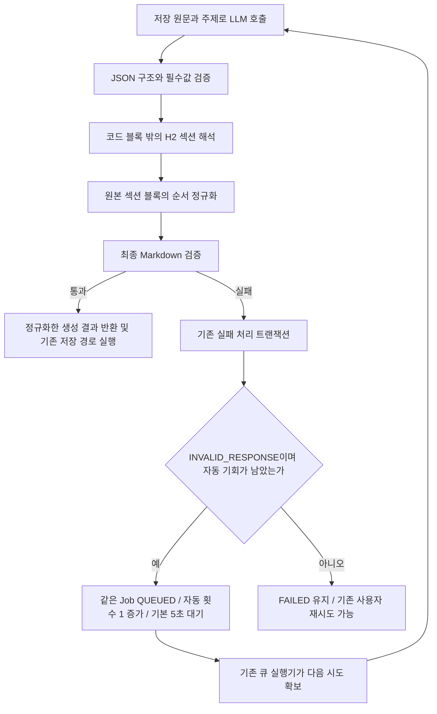

# 문서 생성 섹션 정규화와 실패 작업 복구 계획

상태: 섹션 정규화·예외 응답 자동 재시도 구현 및 로컬 검증 완료
확인일: 2026-10-20

## 1. 범위와 브랜치

- 대상: [#873](https://github.com/woowacourse-teams/2026-Knot/issues/873)
- 기준: `origin/main`의 `30f3de304`, 작업 브랜치 `be/hotfix/#873`, PR 대상 `main`.
- 확정 범위: LLM이 반환한 Markdown의 섹션 본문을 보존하면서 표시 순서를 정리하고, INVALID_RESPONSE를 기존 자동 재시도 대상에 추가한다.
- 자동 재시도는 기존 Job 큐에서 Job당 총 1회, 기본 5초 대기로 처리한다. 다른 자동 재시도 원인과 같은 한도를 공유한다.
- 이미 FAILED인 작업은 배포 후 선별 복구한다. 이 작업에서는 운영 재접수·배포를 실행하지 않는다.

| 근거 | 확인 시점·출처 | 적용 사실 | 판정 |
| --- | --- | --- | --- |
| 사용자 결정 | 2026-10-20, #873 | 순서 차이는 서버에서 정규화하고 main 기반 Hotfix로 분리 | 확정 |
| 운영 장애 | 2026-10-20 Grafana | 4개 Job이 validateSectionOrder에서 INVALID_RESPONSE로 실패. 실제 응답 본문은 없어 재현 입력은 합성 사례 | 운영 관측 |
| 작성 계약 | `backend/src/main/resources/llm/document/generation-system.txt` | 핵심 요약 다음에 존재하는 결정·보류·미결정·할 일, 이후 추가 섹션 | 현재 구현 |
| 재시도 API | [운영 Notion](https://www.notion.so/3ebb43517522802eb145cfbbdd200b73), 수정 10/18 06:03 UTC·캡처 06:10 UTC | 저장 원문으로 기존 FAILED Job만 재접수, 사용자 최대 3회, 마지막 실패 후 168시간, 원본 녹음 시작자만 제어 | 캐시 계약과 현재 코드 일치. 실시간 원문 갱신은 미확인 |
| 작성 형식 배경 | [인터뷰·가설 검증](https://www.notion.so/3b1b4351752280459e37ef3b4def51c1), 10/18 로컬 캡처 | 선택 섹션 생략과 형식 실험은 배경 자료이며 사용자 확정·코드와 구분 | 배경 참고 |
| 재시도 구현과 변경 | `DocumentGenerationRetryPolicy`, `DocumentGenerationFailureService`, `DocumentGenerationJob`, `DocumentGenerationScheduler` | main은 INVALID_RESPONSE 제외. 이 Hotfix에서 대상에 추가하고 자동 총 1회·기본 5초·기존 QUEUED 소비·만료 회수를 재사용 | 사용자 확정·구현 |
| 병행 작업 | 10/20 열린 PR 목록 | #872 배포, #863·#855 FE 작업. 이 정규화 파일을 변경하는 열린 PR 없음 | 조회 시점 관측 |

기존 작업 폴더의 미커밋 변경을 보존하기 위해 별도 worktree를 사용한다. ignored Persona 설정은 기본 작업 폴더의 기존 파일을 읽었다. 새 worktree의 `npx ph workflow implement`는 미초기화 상태이며 구현을 차단하지 않는다고 반환했다. 사용자 Persona 설정을 재초기화하지 않는다.

## 2. 구현할 흐름



핵심 요약을 맨 앞에 두고 실제로 존재하는 결정 → 보류 → 미결정 → 할 일을 배치한다. 추가 섹션의 상대 순서는 유지한다. 없는 섹션을 만들거나 발언을 재분류하지 않는다.

원본 문자열에서 섹션 전체를 잘라 이동해 코드 블록, CRLF, 들여쓰기, Markdown의 줄 끝 공백을 보존한다. 끝 개행이 없던 마지막 블록을 중간으로 옮길 때만 다음 제목과 붙지 않게 구분 개행을 추가한다. 이미 올바른 순서라면 문자열을 그대로 반환한다.

중복 제목, 핵심 요약 누락, 빈 본문, placeholder, 링크, 미완성 코드 블록은 계속 거절한다. 정규화 자체는 LLM을 다시 호출하지 않는다.

### 앞으로의 자동 재시도: 확정 방식과 트레이드오프

기존 Job 큐를 재사용하기로 확정했다. 정규화 이후에도 INVALID_RESPONSE가 발생하면 기존 실패 처리 트랜잭션에서 자동 재시도 가능 횟수를 검사한다. 기회가 남으면 같은 Job을 QUEUED로 전환하고 nextAttemptAt을 설정한다. 기존 실행기가 대기 시각 이후에 실행권을 확보해 저장 원문과 주제로 다시 생성한다. 분류 단계의 잘못된 응답도 같은 원인으로 처리되므로 같은 정책을 적용한다.

| 방식 | 장점 | 비용과 제약 |
| --- | --- | --- |
| 기존 Job 큐 | 재시도 상태·횟수가 DB에 남고 재시작·중복 통지·늦은 결과 차단 경로 재사용 | 기본 5초와 큐 대기 시간 추가. 자동 기회 1회는 다른 오류의 재시도와 공유 |
| 같은 실행에서 즉시 재호출 | 대기 없이 완료할 가능성이 있고 잘못된 응답을 수정 요청에 활용하기 쉬움 | 실행 시간이 늘고 기존 lease와 맞춰야 함. 재호출 기록과 기존 자동 재시도의 중첩 제한 필요 |

같은 프롬프트 재호출이 품질 개선을 보장하지 않는다. INVALID_RESPONSE만 새로 허용하며 인증·잘못된 입력·입출력 한도·원인 불명 INTERNAL은 자동 재시도 대상으로 추가하지 않는다. 기존 TIMEOUT·RATE_LIMITED·UNAVAILABLE·EXECUTION_EXPIRED·STORAGE 정책은 유지한다. 자동 기회와 사용자 재시도 횟수를 분리하고 최종 응답 검증을 통과한 결과만 저장한다. 한 번 실패할 때마다 기회를 새로 주거나 사용자 재시도 시 자동 횟수를 초기화하지 않는다.

### 이미 FAILED인 Job: 별도 복구

정책을 변경해도 과거 FAILED Job은 자동으로 QUEUED가 되지 않는다. 현재 실패 처리 서비스는 현재 RUNNING 시도만 처리하고 실행기는 QUEUED만 소비한다.

1. 수정 배포 후 원문 존재, 현재 상태, 실패 원인, 만료, 사용자 한도를 확인한다. 로그만으로 현재 DB 상태를 확정하지 않는다.
2. 기존 API를 쓰면 원본 녹음 시작자가 로그인·CSRF 검증을 거쳐 `POST /api/v1/workspaces/{workspaceId}/document-generation-jobs/{jobId}/retry`를 호출한다.
3. 서비스는 Workspace·Job·입력 잠금과 권한 검사를 거쳐 같은 Job의 상태·시도 횟수·Batch 집계를 한 트랜잭션에서 바꾼다. 202는 접수이며 완료가 아니다.
4. 실행기는 저장 Transcript로 실패 주제만 다시 생성한다. 이미 성공한 문서는 유지한다.

기존 API는 사용자 기회를 1회 소모한다. 운영자가 타인의 인증 정보를 대신 사용하거나 DB 상태·횟수만 임의로 수정하는 절차를 제안하지 않는다. 서버 버그로 실패한 작업을 사용자 기회 소모 없이 복구하려면 별도 운영 권한과 선별·멱등성·감사 기록을 설계해야 한다.

FAILED 전체를 주기적으로 재접수하는 새 스케줄러는 권장하지 않는다. 고칠 수 없는 실패·만료·입력 유실·사용자 기회와 원인별 재처리 기준까지 새로 정해야 한다.

## 3. 나올 코드와 메서드 초안

| 클래스 | 현재 책임과 변경 | 입력·출력·부작용 |
| --- | --- | --- |
| `DocumentMarkdownSectionReader` | 기존 fence·H2 해석에 원본 offset 추적과 `readBlocks` 추가 | Markdown → 제목별 원본 블록. 중복·미완성 fence 거절 |
| `DocumentMarkdownSectionOrderNormalizer` | 새 순수 변환 클래스, `normalize` | 원본 본문과 고정 순서 → 정규화 본문. DB·네트워크 호출 없음 |
| `DocumentMarkdownValidator` | `normalizeAndValidate` 추가, 기존 strict `validate` 유지 | 생성 결과 → 순서 보정 후 검증한 생성 결과 |
| `LlmDocumentGenerator.generate` | 기존 검증 호출을 정규화·검증 호출로 교체 | 외부 호출은 기존처럼 1회, 반환 본문만 정규화 |
| `DocumentGenerationRetryPolicy` | INVALID_RESPONSE만 자동 재시도 대상에 추가 | 실패 원인 → 자동 재시도 가능 여부. 횟수·지연 설정은 기존 값 유지 |
| `DocumentGenerationFailureService.failAttempt` | 기존 잠금·시도 검사·횟수·집계 원자적 반영 경로 | 현재 시도만 처리하고 중복 통지는 no-op. 현재 변경 없음 |
| `DocumentGenerationJobRetryService.retry` | 기존 사용자 복구 경로 | 기존 Job을 QUEUED로 전환. 거절은 상태·횟수를 바꾸지 않음 |
| `DocumentGenerationScheduler.dispatchQueued` | 기존 큐 소비 | nextAttemptAt 이후 실행권 확보 경로로 전달. 새 스케줄러 추가 안 함 |

## 4. 저장 기반과 주의할 점

정규화에는 DB·마이그레이션 변경이 없다. 기존 Document·Job 저장 트랜잭션을 그대로 사용한다.

외부 LLM 호출은 기존처럼 DB 트랜잭션 밖에서 실행한다. 상태·attemptCount·automaticRetryCount·nextAttemptAt·Batch 집계는 기존 실패 처리 트랜잭션으로 묶는다. 사용자 복구는 userRetryCount를 증가시키며 자동 횟수를 초기화하지 않는다.

운영 복구 대상의 현재 상태와 재접수 권한은 배포 후 확인한다. 기존 API는 사용자 기회를 소모한다는 점을 복구 실행 전에 알린다. 별도 운영 전용 API나 사용자 기회 보상은 이번 Hotfix에 포함하지 않는다.

## 5. TDD와 검증 순서

1. 기존 `main`에서 생성 경계의 순서 회귀 테스트를 먼저 실행했다. 60건 중 25건이 순서 검증에서 실패했다.
2. 원본 블록 순서 정규화와 생성 결과 반환을 구현했다. 같은 회귀 사례가 통과했다.
3. 전체 단위 테스트와 Spotless를 검증했다. 재시도 경로는 PostgreSQL 기반 기존 통합 테스트를 별도로 실행해 검증 범위를 구분한다.
4. 정책 테스트 13건을 추가해 INVALID_RESPONSE 한 건이 기존 코드에서 실패하는 것을 확인했다. 대상 원인만 추가하고 PostgreSQL 횟수·대기·중복·부분 성공 보존 사례를 확장했다.

| 위치·방식 | 검증 동작 | 기대 결과·증명 범위 |
| --- | --- | --- |
| `LlmDocumentGeneratorTest`, Mockito | 고정 섹션 24개 순열, 추가 섹션 사이에 섞인 고정 섹션 | 고정 순서, 추가 상대 순서, LLM 호출 1회 |
| 같은 테스트 | CRLF·코드 안 H2·줄 끝 공백·들여쓰기·표·제목·요약 | 원본 블록 보존, 다른 필드 불변 |
| 같은 테스트 | 끝 개행 없는 블록 이동·정규화 반복 | 제목 연결 방지, 멱등성 |
| 기존 validator 및 생성 테스트 | 중복·빈 본문·placeholder·링크·깨진 JSON·미완성 fence | 기존 오류 유지 |
| `DocumentGenerationRetryPolicyTest`, 단위 | INVALID_RESPONSE 포함 6개 허용·7개 제외 원인 | 인증·입력·한도·원인 불명 실패는 추가 재시도 안 함 |
| `DocumentGenerationExecutionIntegrationTest`, PostgreSQL | INVALID_RESPONSE·429 자동 1회·5초 대기·중복 통지·늦은 응답 | 사용자 횟수 미소모, 자동 소진 후 FAILED |
| 같은 통합 테스트 | 성공 2개 + 실패 1개 → 자동 재실패 → 사용자 재시도 성공 | 성공 문서 보존, 사용자 1회·자동 1회·총 시도 3회 |
| `DocumentGenerationJobRetryTransactionIntegrationTest`, PostgreSQL | 동시 요청·rollback·만료 경계·사용자 한도 | 기존 재접수 트랜잭션 계약 |

검증 명령:

```sh
./gradlew test spotlessCheck
./gradlew integrationTest --tests '*DocumentGenerationExecutionIntegrationTest' --tests '*DocumentGenerationJobRetryTransactionIntegrationTest'
python3 -m unittest discover ../.github/scripts -p 'test_*.py' -q
git diff --check
```

회귀 테스트는 운영 응답을 복원한 재현이 아닌 합성 입력이다. Mockito 검증은 실서버 LLM 품질·속도나 운영 DB 잠금을 증명하지 않는다.

### 2026-10-20 로컬 검증 결과

- `./gradlew test spotlessCheck integrationTest --tests '*DocumentGenerationExecutionIntegrationTest' --tests '*DocumentGenerationJobRetryTransactionIntegrationTest'`: 성공.
- 전체 단위 테스트 2,021건, 관련 PostgreSQL 통합 테스트 28건. 실패·오류·skip 0건. 통합 테스트는 Testcontainers PostgreSQL에서 실행했다.
- Governance 검증기 단위 테스트 10건과 `git diff --check`: 성공.
- Persona 실행 레일은 새 worktree에서 미초기화이며 구현 차단 없이 계속하라고 반환했다. `finish implement`는 `workflow-state-uninitialized`로 실패했다. 기존 사용자 환경을 재초기화하지 않았으며 Persona 완료 인증을 받았다고 주장하지 않는다.
- 운영 LLM 재호출, 운영 Job 재접수, 병합·배포는 수행하지 않았다.

## 6. 완료 기준과 다음 작업

Hotfix 완료 기준은 순서만 잘못된 유효 본문을 한 번의 LLM 호출 결과로 정상 반환하고, 원본 블록과 나머지 거절 규칙을 보존하며 회귀·단위·포맷·관련 통합 검증을 통과하는 것이다. 예외 응답은 기존 큐에서 총 1회만 자동 재시도하고 사용자 기회를 소모하지 않아야 한다. 커밋은 정규화와 직접 테스트, 재시도 정책과 직접 테스트, 계획 문서로 구분한다.

운영 Job 복구 완료는 별도다. 코드 병합·배포 후 현재 DB 상태를 확인하고 선택한 재접수 방식으로 실행한 뒤 SUCCEEDED 및 문서 중복 여부를 관측해야 한다. 로컬 테스트 통과나 PR 생성만으로 운영 복구 완료를 보고하지 않는다.
