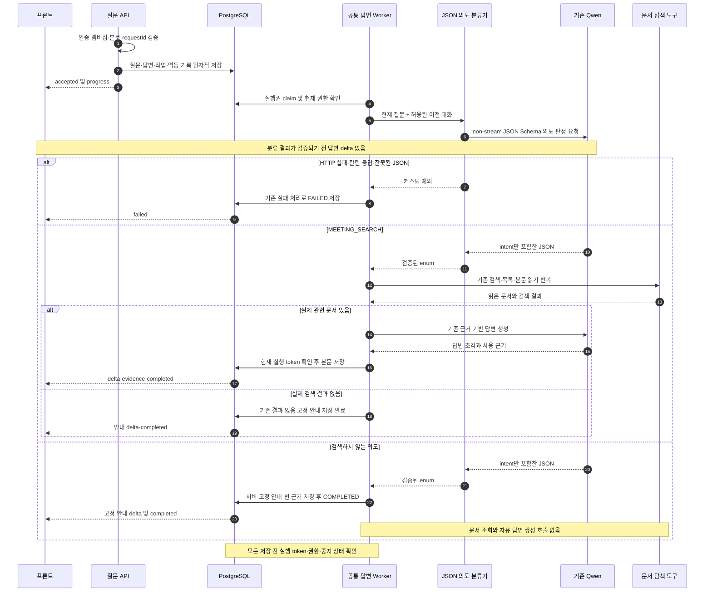

# 탐색 답변 전 JSON 의도 분류 구현 계획

## 1. 범위와 브랜치

- 확인일: 2026-10-15 KST.
- 상태: #697의 승인된 흐름을 TDD로 구현했다. 실제 Qwen 검증을 마쳤으며 최종 전체 Gradle·Persona 종료 결과는 아래 실행 기록에 남긴다.
- 대상 Issue: [#697 — 탐색 답변 전 Qwen JSON 의도 분류와 범위 밖 요청 안내](https://github.com/woowacourse-teams/2026-knot/issues/697).
- 목표: 기존 Qwen을 한 번 호출해 의도를 JSON으로 판정하고, 판정 전에는 첫 답변 `delta`가 나가지 않게 한다. 회의 검색만 MCP 문서 탐색과 답변 생성으로 연결하고 나머지는 서버 고정 안내로 처리한다.
- 적용 진입점: 첫 질문 POST `/api/v1/workspaces/{workspaceId}/search/conversations`, 후속 질문 POST `.../{conversationId}/questions`, 실패 답변 재시도 POST `.../{conversationId}/questions/{questionId}/retry`. 세 API가 공유하는 답변 worker에서 처리한다. 중지·재연결·조회 계약도 회귀 검증한다.
- GitHub의 전체 상태 Issue에서 `의도`, `분류`, `범위`, `탐색`을 검색했다. 이 기능의 기존 Issue는 발견하지 않았다. #663은 검색 결과 없음 안내 수정으로 범위가 다르다. 별도 Issue를 게시한다. 담당자는 흑곰·jyt6640, 라벨은 BE·Feature·흑곰이다.
- 현재 로컬 브랜치: `be/feature/#672`, HEAD `e826050f`. 원격 develop 확인값: `22608131`. 기존 수정·untracked 실험 자료를 보존한다.
- 구현 브랜치 제안: **최신 `origin/develop` → `be/feature/#697`**, PR base는 `develop`. 현재 #672에서 분기하면 별개 로깅 PR #673이 섞이므로 사용하지 않는다. 구현을 시작할 때 다시 fetch하고 깨끗한 별도 worktree를 사용한다. 계획 단계에서는 브랜치를 만들지 않는다.
- #671(DRAFT 문서 탐색 확대), #673(요청 ID 로깅)은 조사 시점 열린 PR이다. 이 기능의 선행 조건으로 두지 않는다. 실제 병합 상태를 구현 시작 시 다시 확인한다. DRAFT 포함 여부를 이번 기능에서 바꾸지 않는다.
- 추정 변경량: production 추가·수정 약 **350~600줄**, 기존 자유 답변 경로 삭제 약 **80~150줄**, 테스트 약 **500~850줄**, 문서 별도. 기존 HTTP·권한·저장·SSE를 재사용하는 기준이다. 단일 PR로 시작하되 실제 diff가 약 2,000줄을 넘으면 파서/adapter와 worker 연결을 분리한다. 아직 구현 diff의 실측값이 아니다.

| 근거 | 확인한 시점·revision | 적용 사실 | 판정 |
| --- | --- | --- | --- |
| 현재 사용자 요청 및 앞선 제품 결정 | 2026-10-15 대화 | 기존 Qwen JSON 분류 채택, 첫 delta 전 판정, 범위 밖은 서버 고정 안내. 새 산출물 작성은 탐색 범위 밖 | 확정 |
| [탐색 · 질문하고 답 받기](https://app.notion.com/p/3edb4351752281b2b973f1190485efd4) | 원문 수정 10/10 08:30 UTC, 본문 캡처 10/10 09:04 UTC | 문서 근거 답변, 한 대화의 동시 생성 제한, 중지 본문 보존, 연결 종료 후 생성 지속 | 선택한 캐시 본문 관측. 운영 원문 실시간 재조회는 아님 |
| [탐색 · 답을 주지 못할 때](https://app.notion.com/p/3edb43517522815f94ecd3c8f692ba7f) | 원문 수정 10/14 04:31 UTC, 본문 캡처 10/14 06:52 UTC | 검색 결과 없음 안내와 실제 생성 실패 구별. 실패 UI는 안내·재시도이며 첫 실패 대화는 목록 숨김 | 선택한 캐시 본문 관측 |
| `SearchAnswerWorker`, `SearchMcpDocumentRetriever`, `SearchRetrievalResult` | 로컬 코드와 develop 대비 | `answer_without_search`의 모델 자유 답변이 DB와 SSE로 전달되는 경로 존재 | 구현 관측 |
| `SearchAnswerExecutionService`, `SearchAnswerSseConnection`, `SearchToolAccess` | 현재 코드 | 실행 token·권한 확인, 본문 저장 후 SSE 전달, 종료 후 늦은 출력 차단을 재사용 가능 | 구현 관측 |
| 로컬 보존 자료 `docs/experiments/search-intent-model-benchmark-results.md`, `experiments/search-intent-benchmark/run.py` | 10/14~15 실제 서버 실험 기록 | Qwen JSON test 399/400, warm p50 562ms·p95 701ms. reasoning 비활성화 필드와 JSON Schema 요청을 확인 | 해당 실험의 관측. 제품 API 통합 성능 증거는 아님. 원래 작업 폴더에 보존한 자료이며 이번 PR에 포함하지 않음 |
| [#663](https://github.com/woowacourse-teams/2026-knot/issues/663), [#671](https://github.com/woowacourse-teams/2026-knot/pull/671), [#673](https://github.com/woowacourse-teams/2026-knot/pull/673) | GitHub 10/15 확인 | 결과 없음은 기존 정상 안내. 열린 PR을 이번 기반에 암묵적으로 포함하지 않음 | 원격 상태 관측 |

비교 정답셋은 Codex가 만든 합성 자료다. 실제 사용자 분포의 정확도나 prompt injection 방어를 보장하지 않는다. 기존 평가의 혼합 요청 정책은 검색 부분 허용 후보였고 이번 제품 결정과 구분한다.

## 2. 구현할 흐름

접수 검증과 원자적 저장은 기존 그대로 사용한다. 접수 이후 worker가 실행권을 확보하고 권한과 실행 기한을 확인한 뒤, 이전 대화와 현재 질문을 JSON으로 제공해 의도 하나를 받는다. `accepted`·`progress`·heartbeat는 판정 전에도 허용하지만 답변 본문 `delta`는 허용하지 않는다.



분류 요청의 기본 계약은 실제 비교 요청을 따른다. 기존 `LlmProperties`의 base URI·key·model을 재사용하고 별도 모델이나 서버를 도입하지 않는다.

```json
{
  "model": "<현재 설정 모델>",
  "stream": false,
  "temperature": 0,
  "max_tokens": 128,
  "reasoning_effort": "none",
  "chat_template_kwargs": {"enable_thinking": false},
  "reasoning": {"enabled": false},
  "messages": [
    {"role": "system", "content": "고정 분류 정책과 다섯 의도의 정의"},
    {"role": "user", "content": "현재 message와 conversationHistory를 직렬화한 JSON"}
  ],
  "response_format": {
    "type": "json_schema",
    "json_schema": {
      "name": "intent",
      "strict": true,
      "schema": {
        "type": "object",
        "properties": {"intent": {"type": "string", "enum": ["MEETING_SEARCH", "GREETING_OR_THANKS", "SERVICE_GUIDE", "NEEDS_CLARIFICATION", "OUT_OF_SCOPE"]}},
        "required": ["intent"],
        "additionalProperties": false
      }
    }
  }
}
```

모델 응답은 `{"intent":"MEETING_SEARCH"}`처럼 의도만 받는다. 모델이 작성한 안내·설명·추론은 클라이언트 답변으로 사용하지 않는다. 공급자 envelope의 정상 종료와 JSON을 모두 서버에서 검증한다. schema 지원 요청만으로 서버 검증을 대신하지 않는다.

| intent | 허용 범위·서버 처리 |
| --- | --- |
| MEETING_SEARCH | 기존 기록 조회·요약·비교. 현재 문서 존재 여부는 검색에서 확인한다. “회의에서 케이크 레시피를 논의했나?”도 기록 조회이므로 허용한다 |
| GREETING_OR_THANKS | 인사·감사·짧은 확인만 있는 요청. 서버 고정 문구 후보: “안녕하세요. 회의 기록에서 궁금한 내용을 질문해 주세요.” |
| SERVICE_GUIDE | Knot 사용법 질문. MVP 고정 문구 후보: “Knot 탐색에서는 모아 둔 회의 문서를 조회·요약·비교할 수 있어요. 찾고 싶은 내용을 질문해 주세요.” |
| NEEDS_CLARIFICATION | 현재 질문과 이전 대화로도 대상을 알 수 없음. 고정 문구 후보: “어떤 회의나 안건을 찾고 싶은지 조금 더 구체적으로 질문해 주세요.” |
| OUT_OF_SCOPE | 일반 지식·레시피·새 코드·새 일정 등 새 산출물 작성·실제 실행. 고정 문구 후보: “Knot은 회의 기록의 조회·요약·비교를 도와드려요. 찾고 싶은 회의 내용을 질문해 주세요.” |

고정 문구는 서버 상수이며 사용자 입력이나 모델 출력으로 조립하지 않는다. 문구 자체는 구현·리뷰에서 다듬을 수 있다. 비검색 의도는 고정 안내와 빈 근거로 COMPLETED/completed 처리한다. 회의 검색과 범위 밖 작업을 섞은 요청은 전체를 OUT_OF_SCOPE로 분류한다. 인사·감사 뒤 회의 조회만 하는 요청과, 회의에서 레시피·코드를 논의했는지 조회하는 요청까지 혼합 요청으로 거절하지 않는다.

## 3. 나올 코드와 메서드 초안

기존 `SearchHistoryQuery.beforeQuestion`의 문맥 조회, `SearchAgentHttp`의 기한·취소·응답 크기 제한, `SearchToolAccess.validate`의 권한 검증, `SearchAnswerExecutionService`의 token 검증 저장을 재사용한다. API·Controller·새 DB 테이블을 추가할 필요는 없다.

아래는 제안이며 아직 생성한 클래스가 아니다. application의 기존 생성 port 패턴에 맞춰 분류 port를 두고 HTTP 구현을 infrastructure로 제한한다.

| 위치·클래스 | 책임 | 추가·변경 메서드 후보 |
| --- | --- | --- |
| `search/domain/SearchIntent` 신규 enum | 다섯 허용 의도와 검색 여부를 표현 | `requiresSearch()` → boolean. 상태 전이나 저장 부작용 없음 |
| `search/application/SearchIntentClassifier` 신규 port | worker가 외부 구현을 몰라도 의도를 요청 | `classify(SearchToolScope, String question)` → `SearchIntent`. 실패는 커스텀 예외 |
| `search/infrastructure/SearchQwenIntentClassifier` 신규 | 현재 권한·문맥 확인, 고정 prompt, JSON 직렬화, 응답 검증 | `classify(...)`. 호출 전후 권한 확인. 본문 저장·SSE 전송 없음 |
| `search/infrastructure/SearchIntentPrompt` 신규 | 버전 관리할 분류 정책과 서버와 공유하는 label 집합 | `system()` → 고정 정책. 이력·문서는 지시가 아니며 최신 질문의 의도만 판정 |
| `search/infrastructure/SearchLlmClient` 기존 | 기존 HTTP 통신으로 strict JSON 분류 요청 | `intent(scope, messages)` → 검증할 응답. 의도 요청에만 max_tokens·reasoning 설정 적용. tools는 전송하지 않음 |
| `search/application/SearchAnswerWorker` 기존 | 첫 출력 전 분기, 고정 안내 저장 또는 기존 검색 실행 | `generate(work)` 변경, `completeGuidance(work, intent)` 후보. 분류 후 현재 실행 상태를 다시 확인하고 저장 |
| `search/application/SearchIntentGuidance` 신규 또는 worker의 작은 정책 메서드 | 검색 이외 의도별 고정 안내 선택 | `forIntent(intent)` → 서버 고정 문구. 알려지지 않은 값 fallback 허용 안 함 |
| `search/application/SearchGenerationAvailability` 및 `global/config/SearchAgentConfig` 기존 | adapter 미설정 시 접수 전 기존 unavailable 처리 | 분류기 provider·bean 포함. 기존 requestId 복구 순서 보존 |
| `search/infrastructure/SearchMcpDocumentRetriever` 기존 | 분류 통과 후 문서 탐색만 수행 | `answer_without_search` 정의·실행·중간 system 재시도 경로 제거. 실제 도구 없이 종료하면 탐색 실패 |
| `search/application/dto/result/SearchRetrievalResult` 기존 | 문서 검색 결과만 표현 | `directAnswer` 필드와 자유 답변 검증 제거. 전체 호출부와 테스트 함께 수정 |

분류 JSON 검증은 응답 envelope 정상 종료, content 문자열, 정확히 하나의 JSON 객체, 필수 intent 문자열, 허용 enum, 추가 필드·중복 키·뒤따르는 JSON 금지를 포함한다. `finish_reason=length`, tool_calls, 누락된 content, 알 수 없는 의도는 실패한다. 정상 응답으로 추정 복구하거나 문자열 일부에서 enum을 찾아 통과시키지 않는다. `SearchToolException` 등 기존 커스텀 예외를 사용한다.

`answer_without_search` 제거는 필수다. 분류가 검색으로 판정했어도 이후 같은 도구가 일반 답변을 저장할 수 있으면 차단 목적이 깨진다. 자유 답변 경로를 제거하고 기존 근거 기반 생성 경로만 남긴다. 분류기가 잘못 허용한 요청에 대한 100% 방어를 의미하지는 않는다.

## 4. 저장 기반과 주의할 점

새 테이블·컬럼·migration은 제안하지 않는다. 의도 JSON은 영속 답변이 아니며 DB·SSE 답변에 저장하지 않는다. 기존 질문 원문, 답변 content/status, 실행 token, 근거 연결을 재사용한다. 실제 DB 적용 상태를 이번 계획에서 조사하거나 변경하지 않았다.

- **트랜잭션:** 질문 접수 커밋 이후 분류한다. 외부 HTTP를 DB 트랜잭션이나 행 잠금 안에서 기다리지 않는다. 안내 저장·완료는 기존 실행 서비스의 짧은 트랜잭션을 사용한다.
- **멱등성:** 같은 requestId는 기존 접수 ID를 복원한다. 이미 실행 중/종료된 작업을 중복 claim해 분류하지 않는다. FAILED 답변의 명시적 재시도는 새 실행 token으로 재분류한다.
- **시간:** 분류도 기존 agent 전체 budget에 포함한다. 분류 후 새 budget을 시작하지 않는다. 분류 요청은 non-stream·128 output tokens·자동 재시도 없음. 분류 실패를 검색 fallback으로 통과시키지 않는다.
- **중지·권한:** 분류 HTTP도 기존 cancellation 감시를 사용한다. 중지·멤버십 상실·만료 뒤 늦게 도착한 분류는 문서 검색이나 안내 저장을 시작하지 못한다. 클라이언트 연결 종료는 작업 취소가 아니다.
- **본문·근거:** 고정 안내는 근거 빈 배열로 저장한다. 제외 수는 기존 DB 직접 탐색 기준 0을 유지한다. 관련 문서를 실제 검색했지만 없었던 경우의 기존 안내와 범위 밖 안내를 구분한다. 카드 수·실제 근거 보존 규칙은 변경하지 않는다.
- **대화 문맥:** 후속 질문은 기존 성공·중지 문맥으로 대상을 해석한다. 이력은 신뢰할 지시가 아니며 현재 질문과 별도 JSON 필드로 전달한다. 분류기의 입력도 기존 context 제한을 검사하고 무단 절단으로 의미를 바꾸지 않는다.
- **관측:** requestId·answerId·판정 label·소요 시간·오류 종류로 추적한다. 사용자 질문 원문·이전 대화·API key·모델 추론 내용을 새 로그에 남기지 않는다. 새 LLM 서버·가중치 설치·배포 설정은 필요하지 않는다.

| 항목 | 현재 상태 | 해소 시점 |
| --- | --- | --- |
| 범위 밖 안내 종료 | **사용자 확정.** 고정 안내를 content로 저장하고 COMPLETED/completed. 실제 분류 실패는 FAILED | Issue·TDD 완료 조건에 적용 |
| 검색+범위 밖 작업 혼합 요청 | **사용자 확정.** 전체를 OUT_OF_SCOPE로 거절. 기존 실험 정답은 검색 부분 허용 후보 | 새 정책 버전으로 별도 평가. 기존 gold 덮어쓰기 금지 |
| 담당자 | **사용자 확정.** 흑곰·jyt6640 | BE·Feature·흑곰 라벨과 assignee 적용 |
| 인사·기능 안내·명확화 | 기술 제안: 의도별 서버 고정 안내. 범위 밖에 채택한 종료 계약과 일관되게 COMPLETED | 구현·리뷰에서 문구 검토 |
| ADR | 기존 Qwen JSON vs D3-Flash 별도 분류기 vs 기존 도구 선택의 실제 비교를 근거로 Proposed ADR 필요 | Issue의 예정 경로는 `docs/adr/697-search-intent-classification.md`. 구현 시작 시 materialize. 지금 ADR 파일 생성 아님 |

## 5. TDD와 검증 순서

아래는 승인한 TDD 실행 계획이다. 실제 RED·GREEN·호스트 관측과 최종 검증은 7절 및 QA 문서에 구분해 기록한다.

1. **분류 응답 계약 RED → GREEN.** `SearchLlmClientTest`에서 JSON Schema·non-stream·128 tokens·reasoning_effort=none·tools 없음 요청을 실제 HTTP fixture로 확인한다. enum 5개 정상, length/HTTP 오류/빈 choices/tool_calls/깨진·중복·추가 JSON은 실패하도록 만든 뒤 최소 구현한다. 기존 complete/stream 요청의 설정은 회귀 검증한다.
2. **분류 입력 RED → GREEN.** 신규 `SearchQwenIntentClassifierTest`에서 현재 질문·허용 이력·안전한 JSON 직렬화, 한 번 호출, 권한 상실·기한 만료·과도한 context 차단을 확인한다. 분류기와 prompt를 구현한다. 이 단위 검증은 실제 Qwen의 판정 정확도 증명이 아니다.
3. **첫 delta 차단 RED → GREEN.** worker 단위 테스트와 HTTP SSE 인수 테스트에서 분류 응답을 latch로 막는다. accepted는 받지만 저장 content와 delta는 비어 있어야 한다. 분류 승인 후만 본문이 생기는 실패를 관측하고 worker 분기를 연결한다. 시간 sleep에 의존하지 않는다.
4. **고정 안내 RED → GREEN.** 비검색 의도별 서버 문자열·빈 근거·확정한 종료 상태를 검증한다. 질문이나 모델이 “케이크 레시피…”를 반환해도 그 문자열은 저장·전송되지 않고 MCP/최종 생성 호출은 0회여야 한다. PostgreSQL에서 실제 content·status·목록 노출을 확인한다.
5. **자유 답변 우회 제거 RED → GREEN.** `SearchMcpDocumentRetrieverTest`에서 검색 판정 뒤 `answer_without_search`를 요청하거나 도구 호출 없이 자유 답변하면 실패하도록 검증한다. 기존 자유 답변 도구·result 필드를 제거한다. 정상 문서 읽기·검색 결과 없음·도구 오류 구분은 유지한다.
6. **첫 질문·후속 질문·재시도 RED → GREEN.** 실제 Security·HTTP·PostgreSQL 인수 테스트에 분류 fixture를 추가한다. 기존 질문 문맥이 필요한 후속 질문, FAILED 재시도, requestId 중복을 검증한다. 분류 실패는 기존 생성 실패 처리로 연결되고 자유 답변은 없어야 한다.
7. **중지·재연결·경합 RED → GREEN.** `SearchTransportStopIntegrationTest` 등에서 분류 중 명시적 중지, 늦은 성공 도착, 멤버십 제거, deadline 만료를 검증한다. STOPPED/FAILED 본문 덮어쓰기와 이후 MCP 호출이 없어야 한다. 연결 끊김은 작업을 유지하고 재연결은 snapshot을 복원하며 재분류하지 않는다.
8. **실제 Qwen 통합 검증.** 제품 adapter가 사용하는 정확한 prompt·request로 한국어 회의 조회·후속 질문·레시피·새 산출물·인젝션·확정한 혼합 정책을 평가한다. 첫/후속/재시도 API에서 accepted→대기→delta→종료와 DB 저장을 관측한다. 분류 요청 p50/p95와 첫 사용자 delta·전체 응답 시간을 별도로 기록한다. 기존 비교 실험 지연값을 제품 지연값으로 복사하지 않는다.

| 검증 방식 | 핵심 시나리오 | 증명하는 결과 |
| --- | --- | --- |
| 단위·Mockito | 다섯 의도 분기, 실패·호출 횟수, 고정 문구 선택 | 제어된 응답에서의 서버 동작 |
| 실제 HTTP fixture | 요청 필드, 공급자 envelope, 잘림·JSON 오류, 연결 취소 | wire 계약과 parser 동작. 실제 모델 판정 품질은 아님 |
| PostgreSQL 통합 | 안내·종료 상태, 빈 근거, 목록 정책, token 경합 | 실제 저장·트랜잭션 결과 |
| Security 포함 HTTP SSE 인수 | 인증·범위 유지, 첫 delta barrier, 세 진입점, 재연결 | 제품 HTTP·저장 흐름 |
| 실제 llm-api Qwen | 허용/거절 오분류·추가 지연, 실제 thinking 비활성화 | 지정 모델·설정·질문셋의 호스트 관측 |

실행 명령은 backend의 실제 Gradle task 구성을 따른다. 테스트 클래스 생성 후 `--tests`로 해당 단위·통합·인수 테스트를 각각 실행하고, 연결 변경 완료 후 아래 공통 검증을 수행한다.

```sh
./gradlew test --tests '*SearchLlmClientTest' --tests '*SearchMcpDocumentRetrieverTest'
./gradlew integrationTest --tests '*SearchTransportStopIntegrationTest' --tests '*SearchAnswerExecutionIntegrationTest'
./gradlew acceptanceTest --tests '*SearchQuestionAcceptanceTest' --tests '*SearchFollowupQuestionAcceptanceTest' --tests '*SearchAnswerRetryAcceptanceTest' --tests '*SearchAnswerEventsAcceptanceTest'
./gradlew spotlessCheck check bootJar
git diff --check
```

새 classifier·worker 테스트는 생성한 실제 이름으로 focused 명령에 추가한다. product 구현 시작 전에 Persona workflow를 실행하고, 종료 시 implementation/review report와 finish 검증을 수행한다. 지금은 계획 작성이므로 해당 구현 rail은 실행하지 않았다.

커밋 경계 제안: 분류 HTTP 계약(test→feat), 의도·고정 안내 분기(test→feat), 자유 답변 우회 제거(test→feat), 중지·재연결 통합 회귀, 문서·ADR. 독립적으로 빌드·검증 가능한 public 동작 단위로 조정한다. 이 제안 자체는 commit·push·PR 요청이 아니다.

## 6. 완료 기준과 다음 작업

계획과 Issue 게시를 완료했다. 하네스 결과는 `status=pass`, `action=publish_issue`, `requested_action=publish_issue`, `remote_write_authorized=true`, `publish_ready=true`, 계약 ID `fca4cf8f637f7243`이다. 사용자 확인으로 인터뷰 완료. Issue #697에 실제 번호가 반영된 ADR 예정 경로를 연결했으며 임시 계약 snapshot을 삭제했다.

구현 완료는 다음을 모두 관측했을 때 판정한다.

- 첫 질문·후속 질문·재시도 모두 분류가 끝나기 전 content delta가 없다.
- 범위 밖 요청에서 모델의 자유 답변 대신 서버 고정 안내만 저장·전송된다. MCP·답변 생성 호출은 없다.
- 정상 회의 검색, 실제 결과 없음, 분류 장애, 중지 상태가 구분되고 기존 API·멱등·권한·재연결 흐름을 유지한다.
- `answer_without_search` 및 `directAnswer`의 자유 본문 전달 경로가 남지 않는다.
- wire fixture·PostgreSQL·Security SSE 검증을 통과하고 실제 Qwen 관측 결과·오분류·지연을 기록한다.
- 혼합 정책을 바꾸면 기존 frozen gold를 덮어쓰지 않고 별도 정책 버전·정답셋 지문으로 평가한다. 새 정책의 점수와 기존 399/400을 동일 기준 수치처럼 비교하지 않는다.
- 알려진 범위 밖 수용과 회의 검색 오거절 사례를 개별 검토한다. 실제 모델 오분류가 남으면 숨기거나 테스트 정답을 맞춰 바꾸지 않고 출시 판단 사항으로 기록한다.

실제 분기·구현·검증 기록은 아래에 남긴다. 새 분류 서버 배포나 D3 도입은 이번 구현에 포함하지 않는다.

## 7. 2026-10-15 구현과 검증 기록

- 보존: 원래 `Desktop/knot`의 `be/feature/#672`와 기존 tracked/untracked 변경을 유지했다. 별도 관리 worktree `/Users/yongtae/.codex/worktrees/search-intent-697/knot`에서 fetch한 `origin/develop 22608131`을 기반으로 `be/feature/#697`를 만들었다. 이 절은 초기 구현 시점의 기록이며 이후 PR 준비 결과는 8절에 남긴다.
- ADR: [697-search-intent-classification.md](../adr/697-search-intent-classification.md)를 검증된 결정 snapshot으로 materialize했다. 상태는 Proposed이며 실제로 논의한 세 대안과 사용자 선택을 보존했다.
- 구현: 기존 Qwen 설정을 재사용하는 classifier와 엄격한 parser, worker의 첫 delta 전 분기, 서버 고정 안내, availability를 연결했다. `answer_without_search`·`directAnswer`와 무도구 재분기 retry를 제거했다. 신규 DB migration·외부 라이브러리·환경변수 없음.
- TDD: 신규 타입/worker 연결의 RED 및 자유 답변 거절 RED(20건 중 10건 실패)를 관측한 뒤 GREEN으로 전환했다. 실제 LM Studio의 정상 `tool_calls: []`를 관측해 []/null RED 2건을 추가한 뒤 호환성을 수정했다. 실제 tool call과 잘못된 JSON의 거절은 유지했다.
- 서버 관측: 실제 PostgreSQL·로컬 HTTP SSE에서 분류 대기 중 본문 없음, 비검색 고정 안내·빈 근거·COMPLETED, 분류 장애 FAILED/no delta, 세 진입점·중지·재연결·권한·token 회귀를 검증했다.
- 실제 Qwen: 최종 30건 모두 예상 의도, median572.5ms/p95 744ms/max2060ms. 후속 문맥·새 산출물·혼합 전체 거절·인젝션 예제를 포함한 합성 smoke다. 실제 Qwen을 연결한 첫/후속/재시도의 서버 안내 저장·SSE도 각각 통과했다. [상세 관측·실패 기록·정답 자료](../qa/697-search-intent-classification.md)를 참조한다.
- 공개 host는 이번 요청에서403이었고 같은 서버의 LM Studio를 SSH 터널로 호출했다. 모델 전체 탐색/답변 품질·Dev 배포·첫 delta 시각은 이번 실제 모델 관측의 범위가 아니다. 분류 오판 가능성도 남는다.
- 실제 코드 변경량: production +394/-135줄, test +1,181/-271줄. 문서 별도. 신규 untracked Java 파일을 포함해 산정했다.
- 최종 자동 검증: Java25로 `./gradlew spotlessCheck check bootJar` PASS(5m10s). XML unit1,443 + integration646 + acceptance566 =2,655, failure/error/skip0. `git diff --check` PASS.
- Persona 종료: 두 `ph plan --report-filled` PASS. `JAVA_HOME=Java25 npx ph workflow finish implement`는 exit1, `evidence-path-unsafe`/`configured-path-unavailable`로 차단됐다. closure status는 추가로 trusted authority 부재·report coverage missing·기존 step-1 pending·workflow loop stale을 표시했다. worktree의 evidence 디렉터리가 존재함은 확인했으나 경로 판정의 원인은 확정하지 않았다. 제품 Gradle 성공과 하네스 종료 실패를 구분하며 과거 ticket/evidence를 삭제하거나 검사를 우회하지 않았다.

## 8. 2026-10-15 PR 준비와 최신 develop 정합성

- 사용자의 commit·push·Draft PR 요청에 따라 JSON 파서, 분류 HTTP 호출, Qwen 문맥 분류, worker 안내 분기, 자유 답변 우회 제거를 각각 직접 테스트와 함께 커밋했다. 문서·ADR·모델 검증 자료는 별도 커밋으로 둔다.
- 최신 `origin/develop 456f5024`의 28개 커밋을 merge commit `f3b1d190`으로 반영했다. #671 DRAFT 탐색과 #673 요청 ID 로깅이 포함되며 `SearchFollowupQuestionAcceptanceTest`의 충돌은 범위 밖 안내와 DRAFT 후속 질문 검증을 모두 보존해 해결했다. 현재 탐색 대상은 최신 develop의 생성 완료 DRAFT·ARCHIVED다.
- 반영 후 Java25 `./gradlew spotlessCheck check bootJar` PASS(5m14s). 단위1,460 + 통합660 + 인수567 = **2,687**, failure/error/skip0. Governance 단위 테스트10건과 `git diff --check`도 PASS.
- develop 대비 production 변경은 +394/-135줄로 동일하다. 신규 API 경로 없이 첫 질문·후속 질문·재시도의 공통 worker 경계에 적용하며 base `develop`, head `be/feature/#697`의 단일 Draft PR로 준비한다.
- 초기 Persona 종료 미통과와 실제 모델 관측의 한계는 그대로 남긴다. 이번 최신 develop 정합 검증은 로컬 Gradle·HTTP fixture·PostgreSQL 기준이며 실제 모델을 다시 호출한 결과로 표현하지 않는다.
